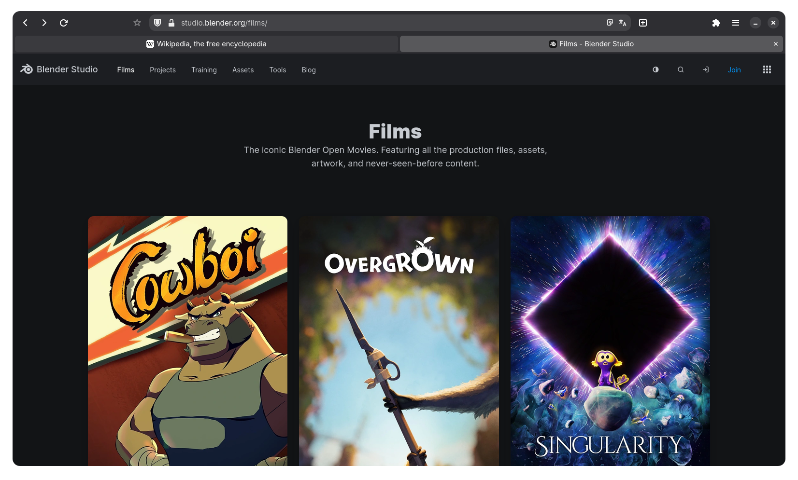
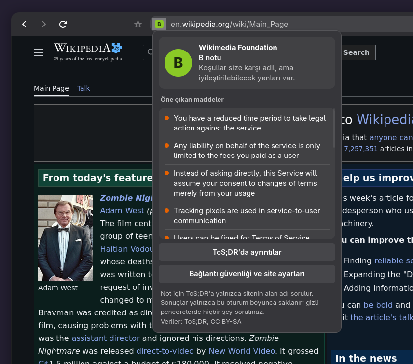
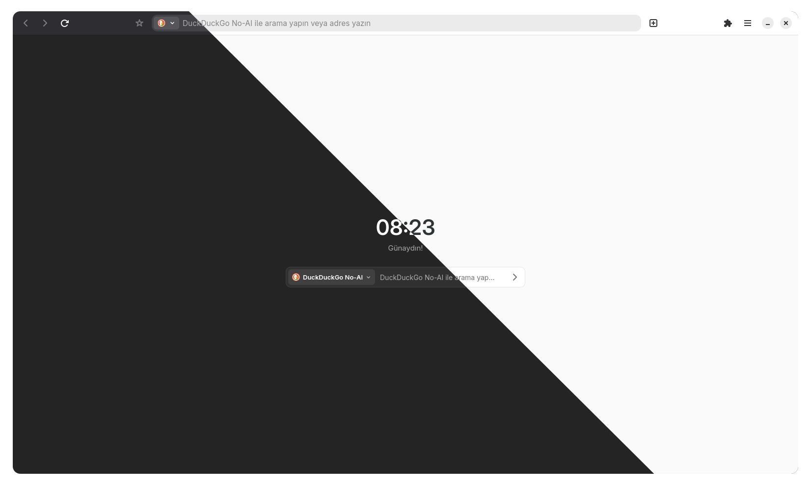
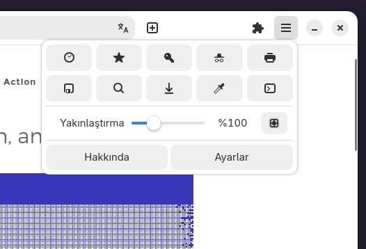

# Marmara Browser

**Simple and transparent.**

🇹🇷 [Türkçe](README.tr.md)

Marmara is built on [LibreWolf](https://librewolf.net) (and so on Firefox). It takes
LibreWolf's privacy-hardened browser and gives it a clean design that follows the GNOME
Human Interface Guidelines, simple settings, a few extras and its own name. It is not a from-scratch browser and it does not compile Firefox:
it repacks LibreWolf's ready-made files, so every new LibreWolf release can become a new
Marmara release automatically.



## The idea

Marmara takes its inspiration from jellyfish, and so does its logo.

- **Transparent**, like a jellyfish: the code is open source, nothing is hidden, there is
  no telemetry, and nothing is chosen for you.
- **Simple**, like its shape: easy to use and functional. Sensible defaults, a small
  settings window instead of hundreds of options, and a clean design that follows the
  GNOME Human Interface Guidelines.

## Features

- **Adwaita-style design:** address bar in the title bar, tabs below, libadwaita
  colors and corners, light and dark mode, system accent color.
- **Private by default:** LibreWolf's settings — no telemetry, strict tracking protection,
  HTTPS-only.
- **Useful extensions built in:** uBlock Origin, Privacy Badger, ClearURLs and
  ToS;DR are installed on first run and also work in private windows.
- **Terms of service at a glance (optional):** the address bar can show the
  [ToS;DR](https://tosdr.org) rating of the site you are visiting. It is **off by
  default**, because it sends the site's domain name to ToS;DR; Marmara asks you on
  first run. Nothing is sent from private windows.
- **Simple settings:** one small Adwaita-style window instead of a long page of
  options, with search.
- **First-run welcome:** pick your language, theme and search engine yourself.
  Nothing is chosen for you.
- **Its own identity:** own name, logo, profile folder (`~/.marmara`) and window class.
  It can run next to LibreWolf.

| | |
|---|---|
|  |  |
|  | |

## Install

### Flatpak (Linux)

```sh
flatpak remote-add --user marmara https://fuzuliorg.github.io/marmara/marmara.flatpakrepo
flatpak install --user marmara io.github.fuzuliorg.Marmara
flatpak run io.github.fuzuliorg.Marmara
```

Update with:

```sh
flatpak update io.github.fuzuliorg.Marmara
```

Marmara tells you in **Settings → General → Updates** when a new version is out.
The repository is signed; the key is included in `marmara.flatpakrepo`.

> Marmara is not on Flathub (yet), so software centers like Bazaar will not list it.
> GNOME Software and the commands above work.

### AppImage (Linux)

Download `Marmara-<version>-x86_64.AppImage` from the [latest release](https://github.com/fuzuliorg/marmara/releases/latest), then:

```sh
chmod +x Marmara-*-x86_64.AppImage
./Marmara-*-x86_64.AppImage
```

It uses your system's GTK 3 and keeps your profile in `~/.marmara`, like the other builds. To update, download the new AppImage (or use a tool such as AppImageUpdate; the update information is embedded).

### Windows

Download `Marmara-<version>-windows-x86_64-setup.exe` from the
[latest release](https://github.com/fuzuliorg/marmara/releases/latest) and run it.
No administrator rights are needed. It installs for your user, adds Start menu and
desktop shortcuts, and can be removed from Windows *Installed apps* (your profile —
bookmarks, history — is kept).

> The installer is not code-signed, so Windows SmartScreen may warn you; choose
> *More info → Run anyway*. Updates are one click: when a new version is out, press
> **Update now** in **Settings → General → Updates**. Marmara downloads the installer,
> checks its checksum, installs over the old version and restarts.
>
> A portable `marmara-<version>-windows-x86_64.zip` (unpack anywhere, run `marmara.exe`)
> is also published; it does not update itself and opens the release page instead.

### From the release archive (Linux)

Download `marmara-<version>-linux-x86_64.tar.xz` from the
[latest release](https://github.com/fuzuliorg/marmara/releases/latest), unpack it
and run `./marmara/marmara`.

## What Marmara connects to

Measured on a fresh install, left idle for five minutes with no page opened. Everything
else only happens when you visit a site.

| Address | Why |
|---|---|
| `ublockorigin.github.io`, `ublockorigin.pages.dev` | uBlock Origin updates its filter lists |
| `rules2.clearurls.xyz` | ClearURLs updates its rules |
| `*.cdn.mozilla.net` | Firefox's Remote Settings: certificate-revocation filters and block lists, verified with signatures |
| `push.services.mozilla.com` | Firefox's push service, which tells the browser when new Remote Settings data is ready (also used for web push notifications). Left on so security updates arrive promptly |

There is no telemetry, no Google, no sponsored content, and no account. Marmara checks
for its own updates only when you press the button in Settings, and then talks to
`api.github.com` and `github.com`. Terms of Service ratings are off unless you turn them
on; if you do, the site's domain name is sent to ToS;DR.

## Reporting problems

Open an [issue](https://github.com/fuzuliorg/marmara/issues/new). Marmara's
**About → Report an issue** button goes to the same place.

## Building it yourself

See [CONTRIBUTING.md](CONTRIBUTING.md).

## Terms of use

By using Marmara you accept the [terms of use](TERMS.md) ([Türkçe](TERMS.tr.md)).

## License

Marmara's own files and the files modified from LibreWolf/Firefox are under the
[Mozilla Public License 2.0](LICENSE).

**The name "Marmara" and its logo are not covered by that license.** You may fork the
code freely, but a modified version may not use the Marmara name or logo. See
[TRADEMARK.md](TRADEMARK.md).

Marmara is not developed or endorsed by Mozilla or the LibreWolf project. "Firefox" and
"LibreWolf" belong to their owners and are only mentioned to say where Marmara comes
from. Preinstalled extensions belong to their developers and are downloaded unchanged
from addons.mozilla.org.
